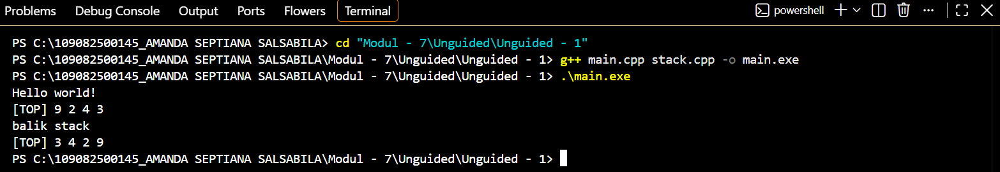
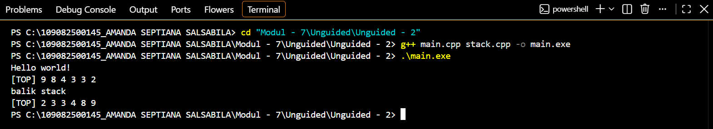
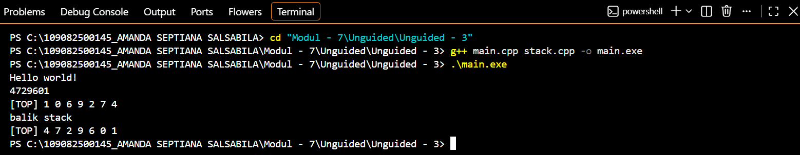

# <h1 align="center">Laporan Praktikum Modul 7 - STACK </h1>
<p align="center">Amanda Septiana Salsabila - 109082500145</p>

## Dasar Teori
Struktur data adalah cara penyimpanan, pengorganisasian, dan pengaturan data di dalam media penyimpanan komputer agar data dapat digunakan secara efisien[1]. Struktur data majemuk yang bersifat linier antara lain stack, queue, dan list[1]. Salah satunya, stack atau tumpukan, memiliki hubungan erat dengan singly linked list, karena komponen penyusunnya pada dasarnya sama dan yang berbeda hanyalah aturan aksesnya, yaitu hanya pada elemen paling awal[3].

### A. Konsep Dasar Stack<br/>
Stack adalah list linier yang elemen puncaknya (TOP) dapat dikenali, dengan aturan penyisipan dan penghapusan elemen yang tertentu[1].
### 1. Pengertian dan Prinsip LIFO
Penyisipan selalu dilakukan di atas TOP dan penghapusan selalu dilakukan pada TOP, sehingga TOP menjadi satu-satunya tempat terjadinya operasi[1]. Akibatnya, elemen yang ditambahkan paling akhir akan menjadi elemen yang dihapus pertama. Prinsip ini disebut LIFO (Last In First Out)[1][3]. Struktur ini banyak dipakai untuk pemanggilan prosedur, perhitungan ekspresi aritmatika, rekursif, dan backtracking[1]. Contoh lainnya adalah konversi ekspresi aritmatika ke notasi postfix oleh compiler[1].
### 2. Stack sebagai Tipe Data Abstrak (ADT)
ADT mengemas suatu struktur data sekaligus operasi-operasi yang dapat dilakukan terhadapnya[1]. Dengan ADT, implementasi dapat diubah tanpa mengubah program pengguna selama interface-nya tetap[1]. Hal ini sejalan dengan konsep pemrograman modular, yaitu memecah masalah menjadi bagian-bagian kecil berupa fungsi atau prosedur agar program lebih mudah disusun dan dipahami[2]. Pada Modul 7, ADT stack dideklarasikan dalam file header (.h) yang berisi tipe data dan prototype primitif, lalu diimplementasikan dalam file .c/.cpp[3].
### 3. Primitif pada Stack
Primitif stack pada dasarnya sama dengan primitif list lainnya, tetapi jumlahnya lebih sedikit karena operasi hanya dilakukan pada elemen paling atas. Primitif tersebut antara lain createStack(), isEmpty(), alokasi(), dealokasi(), dan fungsi pencarian[3]. Definisi fungsional stack pada [1] mencakup CreateEmpty, IsEmpty, IsFull, Push, dan Pop. Stack kosong didefinisikan sebagai stack dengan Top bernilai Nil[1].

### B. Operasi pada Stack
Stack memiliki dua operasi utama, yaitu penyisipan (push) dan pengambilan (pop)[3].
### 1. Push
Push menambahkan satu elemen ke dalam stack, dan elemen baru tersebut menempati posisi TOP[1]. Operasi ini setara dengan insert first pada list[3]. Pada representasi pointer, langkahnya adalah membuat elemen baru, mengarahkan next-nya ke Top yang lama, lalu menjadikannya Top yang baru[3].
### 2. Pop
Pop mengeluarkan elemen yang berada pada posisi TOP sehingga jumlah elemen berkurang dan TOP berpindah[1]. Operasi ini setara dengan delete first pada list linier[3]. Pada representasi pointer, Top disimpan ke variabel bantu, Top dipindah ke next, lalu elemen yang disimpan dikembalikan[3]. Pop tidak dapat dilakukan pada stack kosong karena akan menimbulkan kondisi error[1].

### C. Representasi Stack
### 1. Representasi Pointer
Pada representasi ini, stack disusun dari node yang dihubungkan secara linier dengan bantuan pointer[1]. Setiap elemen memiliki bagian info dan next, sedangkan stack hanya menyimpan satu penunjuk, yaitu Top[3]. Ukurannya dinamis, sehingga diperlukan manajemen memori (alokasi dan dealokasi)[3].
### 2. Representasi Tabel (Array)
Array adalah himpunan hingga elemen yang terurut dan homogen, serta bersifat statis karena alokasi memorinya terbatas[1]. Dalam C++, array termasuk tipe data terstruktur yang terdiri dari sejumlah komponen bertipe sama dan memungkinkan penyimpanan banyak data dengan satu nama variabel[2]. Representasi tabel sangat cocok untuk stack karena penambahan dan pengurangan elemen hanya terjadi di satu ujung[1]. Pada representasi ini :
- TOP berupa indeks elemen puncak, dan stack kosong ditandai dengan Top = 0[1][3].
- Jumlah tumpukan terbatas hingga indeks maksimum (Imax)[3].
- Push dilakukan dengan Top = Top + 1, lalu mengisi data pada indeks tersebut[3].
- Pop dilakukan dengan mengambil S.info[Top] lalu Top = Top - 1, tanpa menghapus isi indeks sebelumnya[3].
- Tidak diperlukan manajemen memori seperti pada representasi pointer[3].
- Elemen stack dapat berupa tipe terstruktur (struct/record) yang terdiri dari beberapa field[2], misalnya nim dan nama pada contoh ADT di Modul 7[3].

## Guided 

### 1. Stack
### a. stack.h
```C++
#ifndef STACK_H_INCLUDED
#define STACK_H_INCLUDED

#include <iostream>
using namespace std;

struct infotype {
    char nim[20];
    char nama[20];
};
struct Stack {
    infotype info[10];
    int Top;
};

int isEmpty(Stack S);

void createStack(Stack &S);

void push(Stack &S, infotype X);

void pop(Stack &S, infotype &X);

void viewStack(Stack S);

#endif 
```

### b. stack.cpp
```C++
#include "stack.h"

int isEmpty(Stack S) {
    if (S.Top == 0) {
        return 0;
    } else {
        return 1;
    }
}

void createStack(Stack &S) {
    S.Top = 0;
}

void push(Stack &S, infotype X) {
    if (S.Top < 10) {
        S.Top = S.Top + 1;
        S.info[S.Top - 1] = X;
    } else {
        cout << "Stack penuh, data tidak bisa ditemukan" << endl;
    }
}

void pop(Stack &S, infotype &X) {
    if (isEmpty(S) != 0) {
        X = S.info[S.Top - 1];
        S.Top = S.Top - 1;
    } else {
        cout << "Stack kosong, tidak ada data yang bisa diambil" << endl;
    }
}

void viewStack(Stack S) {
    if(isEmpty(S) == 0) {
        cout << "Stack kosong" << endl;
    } else {
        cout << "Isi stack (dari TOP):" << endl;
        for (int i = S.Top; i >= 1; i--) {
            cout << i << ". " << S.info[i - 1].nim << " - "
                 << S.info[i - 1].nama << endl;
        }
    }
}
```

### c. main.cpp
```C++
#include <iostream>
#include <cstring>
#include "stack.h"
using namespace std; 

int main() {
    Stack S;
    infotype data, hasil;

    createStack(S);
    cout << "Stack baru dibuat, Top = " << S.Top << endl;
    viewStack(S);

    cout << endl << "--- Push 3 data ---" << endl;
    strcpy(data.nim, "103112400001");
    strcpy(data.nama, "Andi");
    push(S, data);

    strcpy(data.nim, "103112400002");
    strcpy(data.nama, "Budi");
    push(S, data);

    strcpy(data.nim, "103112400003");
    strcpy(data.nama, "Citra");
    push(S, data);
    viewStack(S);

    cout << endl << "--- Pop 1 data ---" << endl;
    pop(S, hasil);
    cout << "Data yang diambil: " << hasil.nim << " - " << hasil.nama << endl;
    viewStack(S);

    cout << endl << "--- Pop sampai kosong ---" << endl;
    pop(S, hasil);
    pop(S, hasil);
    pop(S, hasil);
    viewStack(S);

    return 0;
}
```
Program ini memodelkan struktur data Stack menggunakan array berkapasitas 10 elemen untuk menyimpan data bertipe infotype yang terdiri dari NIM dan nama. Cara kerjanya berfokus pada manipulasi indeks Top sebagai penanda jumlah elemen, di mana operasi push akan menyisipkan data baru dengan menaikkan nilai Top sebelum data disimpan, sedangkan pop mengambil data dari posisi teratas lalu menurunkan nilai Top. Selain itu, terdapat fungsi isEmpty untuk mengecek ketersediaan data dan viewStack untuk menampilkan isi stack dari elemen teratas ke terbawah, yang seluruhnya diuji pada program utama melalui serangkaian proses penyisipan dan pengambilan data mahasiswa menggunakan bantuan fungsi strcpy.

## Unguided 

### 1. Buatlah ADT Stack menggunakan ARRAY sebagai berikut di dalam file “stack.h”:  
```
Type infotype : integer 
Type Stack < 
    info : array [20] of integer 
    top : integer 
>
procedure CreateStack( input/output S : Stack ) 
procedure push(input/output S : Stack,
    input x : infotype)
function pop(input/output t S : Stack )
      → infotype 
procedure printInfo( input S : Stack )
procedure balikStack(input/output S : 
    Stack )
```
### Buatlah implementasi ADT Stack menggunakan Array pada file “stack.cpp” dan “main.cpp” 
```
int main() 
{  
    cout << "Hello world!" << endl;  
    Stack S;  
    createStack(S);  
    Push(S,3);  
    Push(S,4);  
    Push(S,8);  
    pop(S)  
    Push(S,2);  
    Push(S,3);  
    pop(S);  
    Push(S,9);  
    printInfo(S);  
    cout<<"balik stack"<<endl;  
    balikStack(S);  
    printInfo(S);  
    return 0; 
} 
``` 
### a. stack.h
```C++
#ifndef STACK_H
#define STACK_H

typedef int infotype;

struct Stack {
    infotype info[20];
    int top;
};

void createStack(Stack &S);
void push(Stack &S, infotype x);
infotype pop(Stack &S);
void printInfo(Stack S);
void balikStack(Stack &S);

#endif
```
### b. stack.cpp
```C++
#include "stack.h"
#include <iostream>
using namespace std;

void createStack(Stack &S) {
    S.top = 0;
}

void push(Stack &S, infotype x) {
    S.info[S.top] = x;
    S.top = S.top + 1;
}

infotype pop(Stack &S) {
    S.top = S.top - 1;
    return S.info[S.top];
}

void printInfo(Stack S) {
    if (S.top == 0) {
        cout << "Stack kosong" << endl;
        return;
    }
    cout << "[TOP] ";
    for (int i = S.top - 1; i >= 0; i--) {
        cout << S.info[i] << " ";
    }
    cout << endl;
}

void balikStack(Stack &S) {
    int kiri = 0;
    int kanan = S.top - 1;
    while (kiri < kanan) {
        infotype temp = S.info[kiri];
        S.info[kiri] = S.info[kanan];
        S.info[kanan] = temp;
        kiri = kiri + 1;
        kanan = kanan - 1;
    }
}
```
### c. main.cpp
```C++
#include <iostream>
#include "stack.h"
using namespace std;

int main() {
    cout << "Hello world!" << endl;

    Stack S;
    createStack(S);

    push(S, 3);
    push(S, 4);
    push(S, 8);
    pop(S);
    push(S, 2);
    push(S, 3);
    pop(S);
    push(S, 9);

    printInfo(S);

    cout << "balik stack" << endl;
    balikStack(S);

    printInfo(S);

    return 0;
}
```
### Output Unguided 1 :

##### Output 1


Program ini menerapkan struktur data Stack berbasis array dengan kapasitas 20 elemen, di mana fungsi push menyimpan nilai pada indeks top lalu menaikkannya, sedangkan pop mengambil elemen teratas dengan menurunkan indeks top terlebih dahulu. Terdapat pula fungsi printInfo untuk menampilkan isi stack dari atas ke bawah, serta balikStack yang membalik urutan elemen secara langsung menggunakan teknik pertukaran posisi dari kedua ujung array.

### 2. Tambahkan prosedur pushAscending( in/out S : Stack, in x : integer)
```
int main() 
{  
    cout << "Hello world!" << endl;  
    Stack S;  
    createStack(S);  
    pushAscending(S,3); 
    pushAscending(S,4); 
    pushAscending(S,8); 
    pushAscending(S,2); 
    pushAscending(S,3); 
    pushAscending(S,9); 
    printInfo(S); 
    cout<<"balik stack"<<endl; 
    balikStack(S); 
    printInfo(S); 
    return 0; 
}  
``` 

### a. stack.h
```C++
#ifndef STACK_H
#define STACK_H

typedef int infotype;

struct Stack {
    infotype info[20];
    int top;
};

void createStack(Stack &S);
void push(Stack &S, infotype x);
infotype pop(Stack &S);
void printInfo(Stack S);
void balikStack(Stack &S);
void pushAscending(Stack &S, infotype x);

#endif
```
### b. stack.cpp
```C++
#include "stack.h"
#include <iostream>
using namespace std;

void createStack(Stack &S) {
    S.top = 0;
}

void push(Stack &S, infotype x) {
    S.info[S.top] = x;
    S.top = S.top + 1;
}

infotype pop(Stack &S) {
    S.top = S.top - 1;
    return S.info[S.top];
}

void printInfo(Stack S) {
    if (S.top == 0) {
        cout << "Stack kosong" << endl;
        return;
    }
    cout << "[TOP] ";
    for (int i = S.top - 1; i >= 0; i--) {
        cout << S.info[i] << " ";
    }
    cout << endl;
}

void balikStack(Stack &S) {
    int kiri = 0;
    int kanan = S.top - 1;
    while (kiri < kanan) {
        infotype temp = S.info[kiri];
        S.info[kiri] = S.info[kanan];
        S.info[kanan] = temp;
        kiri = kiri + 1;
        kanan = kanan - 1;
    }
}

void pushAscending(Stack &S, infotype x) {
    Stack temp;
    createStack(temp);
    while (S.top > 0 && S.info[S.top - 1] > x) {
        push(temp, pop(S));
    }
    push(S, x);
    while (temp.top > 0) {
        push(S, pop(temp));
    }
}
```
### c. main.cpp
```C++
#include <iostream>
#include "stack.h"
using namespace std;

int main() {
    cout << "Hello world!" << endl;
    Stack S;
    createStack(S);
    pushAscending(S, 3);
    pushAscending(S, 4);
    pushAscending(S, 8);
    pushAscending(S, 2);
    pushAscending(S, 3);
    pushAscending(S, 9);
    printInfo(S);
    cout << "balik stack" << endl;
    balikStack(S);
    printInfo(S);
    return 0;
}
```
### Output Unguided 2 :

##### Output 1


Program ini menerapkan struktur data Stack berbasis array yang dilengkapi prosedur `pushAscending` untuk menjaga urutan elemen tetap menaik dari bawah ke atas. Saat menyisipkan nilai baru, elemen-elemen yang lebih besar dari nilai tersebut dipindahkan ke stack sementara, lalu nilai baru dimasukkan, dan elemen-elemen tadi dikembalikan ke stack utama. Dengan cara ini, elemen terbesar selalu berada di posisi TOP.


### 3. Tambahkan prosedur getInputStream( in/out S : Stack ). Prosedur akan terus membaca dan menerima input user dan memasukkan setiap input ke dalam stack hingga user menekan tombol enter. Contoh: gunakan cin.get() untuk mendapatkan inputan user.
```
int main() 
{ 
    cout << "Hello world!" << endl; 
    Stack S; 
    createStack(S); 
    getInputStream(S); 
    printInfo(S); 
    cout<<"balik stack"<<endl; 
    balikStack(S); 
    printInfo(S); 
    return 0; 
} 
```

### a. stack.h
```C++
#ifndef STACK_H
#define STACK_H

typedef int infotype;

struct Stack {
    infotype info[20];
    int top;
};

void createStack(Stack &S);
void push(Stack &S, infotype x);
infotype pop(Stack &S);
void printInfo(Stack S);
void balikStack(Stack &S);
void getInputStream(Stack &S);

#endif
```
### b. stack.cpp
```C++
#include "stack.h"
#include <iostream>
using namespace std;

void createStack(Stack &S) {
    S.top = 0;
}

void push(Stack &S, infotype x) {
    S.info[S.top] = x;
    S.top = S.top + 1;
}

infotype pop(Stack &S) {
    S.top = S.top - 1;
    return S.info[S.top];
}

void printInfo(Stack S) {
    if (S.top == 0) {
        cout << "Stack kosong" << endl;
        return;
    }
    cout << "[TOP] ";
    for (int i = S.top - 1; i >= 0; i--) {
        cout << S.info[i] << " ";
    }
    cout << endl;
}

void balikStack(Stack &S) {
    int kiri = 0;
    int kanan = S.top - 1;
    while (kiri < kanan) {
        infotype temp = S.info[kiri];
        S.info[kiri] = S.info[kanan];
        S.info[kanan] = temp;
        kiri = kiri + 1;
        kanan = kanan - 1;
    }
}

void getInputStream(Stack &S) {
    char c;
    while (cin.get(c) && c != '\n') {
        if (c >= '0' && c <= '9') {
            push(S, c - '0');
        }
    }
}
```
### c. main.cpp
```C++
#include <iostream>
#include "stack.h"
using namespace std;

int main() {
    cout << "Hello world!" << endl;
    Stack S;
    createStack(S);
    getInputStream(S);
    printInfo(S);
    cout << "balik stack" << endl;
    balikStack(S);
    printInfo(S);
    return 0;
}
```
### Output Unguided 3 :

##### Output 1


Program ini menerapkan struktur data Stack berbasis array yang dilengkapi prosedur getInputStream untuk membaca input dari user secara berkelanjutan hingga tombol Enter ditekan. Prosedur ini menggunakan fungsi cin.get() untuk mengambil satu karakter pada setiap iterasi, lalu mengonversinya menjadi nilai integer dengan mengurangkan karakter '0' sebelum disisipkan ke dalam stack. Dengan cara ini, setiap digit yang diinputkan user akan tersimpan berurutan di dalam stack, dan elemen terakhir yang diinput akan berada di posisi TOP sesuai prinsip LIFO.

## Kesimpulan
Berdasarkan praktikum Modul 7, dapat disimpulkan bahwa struktur data Stack merupakan bentuk linear yang bekerja dengan prinsip LIFO (Last In First Out), di mana operasi penyisipan (push) dan pengambilan (pop) data hanya dilakukan pada satu sisi, yaitu posisi teratas (top). Implementasi stack menggunakan representasi tabel (array) terbukti efektif untuk mengelola data dengan kapasitas terbatas melalui manipulasi indeks top secara langsung tanpa memerlukan manajemen memori dinamis. Selain operasi dasar, penambahan prosedur khusus seperti pushAscending, balikStack, dan getInputStream menunjukkan fleksibilitas stack dalam menangani kasus yang lebih kompleks. Hal ini mencakup kemampuan menjaga urutan data tetap terurut menggunakan stack bantuan, membalik urutan elemen secara langsung di dalam array, serta memproses input karakter pengguna secara berurutan. Secara keseluruhan, praktikum ini memperkuat pemahaman praktis mengenai cara kerja stack dan penerapannya dalam menyelesaikan masalah yang membutuhkan manipulasi data secara berurutan dan terbalik.

## Referensi
[1] Triase. (2020). Diktat Edisi Revisi : STRUKTUR DATA. Medan: UNIVERSITAS ISLAM NEGERI SUMATERA UTARA MEDAN. 
<br>[2] Indahyanti, Uce., Rahmawati, Yunianita. (2020). “BUKU AJAR ALGORITMA DAN PEMROGRAMAN DALAM BAHASA C++”. Sidoarjo: Umsida Press. Diakses pada 10 Maret 2024 melalui https://doi.org/10.21070/2020/978-623-6833-67-4.
<br>[3] Informatics Laboratory, Fakultas Informatika, Telkom University. (t.t.). Modul 7: Stack. Modul Praktikum Struktur Data.