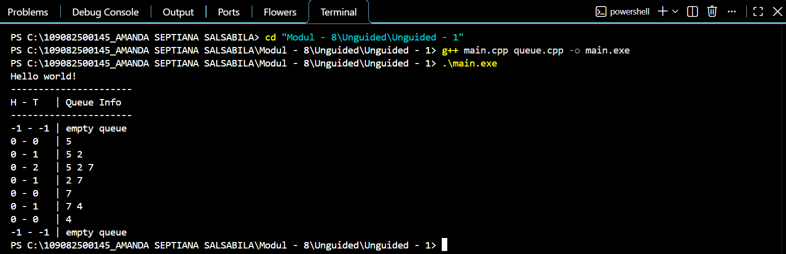
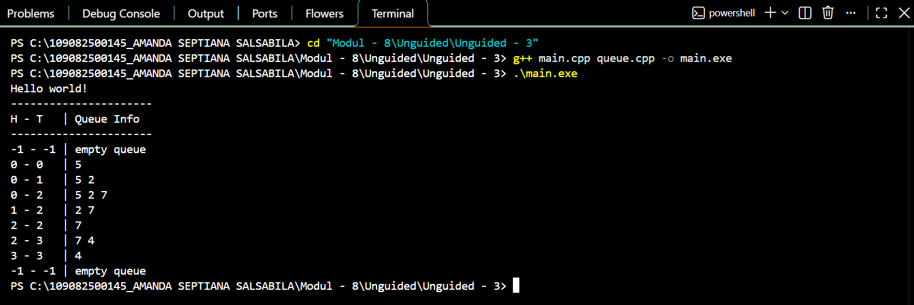

# <h1 align="center">Laporan Praktikum Modul 8 - QUEUE </h1>
<p align="center">Amanda Septiana Salsabila - 109082500145</p>

## Dasar Teori
Queue atau antrean adalah salah satu bentuk struktur data linear yang cara kerjanya seperti antrean di dunia nyata, misalnya antrean pada loket pembelian tiket kereta api [3]. Prinsip dasarnya adalah FIFO (First In First Out), yaitu elemen yang pertama kali masuk akan menjadi elemen yang pertama kali dilayani atau dikeluarkan [1][3]. Penyisipan elemen selalu dilakukan di bagian belakang (tail), sedangkan penghapusan elemen selalu dilakukan di bagian depan (head) [3]. Queue dapat diimplementasikan dengan dua cara, yaitu menggunakan linked list (pointer) dan menggunakan array (tabel) [2][3].

### A. Queue dengan Representasi Linked List (Pointer)<br/>
Pada representasi pointer, setiap elemen queue disimpan dalam sebuah node yang saling terhubung melalui pointer. Jumlah elemen tidak dibatasi dan memori dikelola secara dinamis melalui alokasi dan dealokasi [3]. Queue dinyatakan kosong jika head dan tail bernilai Nil [3].
1. Struktur data. Setiap elemen (elmQueue) terdiri dari info untuk menyimpan data dan next untuk menunjuk elemen berikutnya. Queue itu sendiri terdiri dari dua pointer, yaitu head dan tail [3].
2. Operasi Enqueue (Insert). Penyisipan selalu dilakukan di akhir queue. Langkahnya: membuat elemen baru dengan next = Nil, menyambungkan tail->next ke elemen baru, lalu memindahkan tail ke elemen baru tersebut [3].
3. Operasi Dequeue (Delete). Penghapusan selalu dilakukan di awal queue. Langkahnya yaitu P menunjuk head, head dipindahkan ke elemen berikutnya, lalu P->next diisi Nil dan elemen P dikembalikan. Queue bisa menjadi kosong setelah operasi ini [3].

### B. Queue dengan Representasi Tabel (Array)
Representasi tabel memiliki kapasitas yang terbatas (NMax) dan tidak memerlukan manajemen memori dinamis, berbeda dengan representasi pointer [2][3]. Queue kosong ditandai dengan head = 0 (atau -1 pada indeks C++ yang dimulai dari 0) [3]. Terdapat tiga alternatif mekanisme :
1. Alternatif 1 (head diam, tail bergerak). head selalu berada di indeks pertama selama queue tidak kosong. Penambahan elemen dilakukan dengan memajukan tail. Pada penghapusan, seluruh elemen setelah head digeser ke depan lalu tail mundur. Cara ini mirip pergeseran orang yang mengantre di dunia nyata, tetapi tidak efisien karena ada proses pergeseran [3].
2. Alternatif 2 (head bergerak, tail bergerak). Pada penghapusan, head cukup dimajukan tanpa menggeser elemen, sehingga lebih efisien. Kekurangannya, queue dapat berada dalam kondisi penuh semu, yaitu tail sudah mencapai indeks maksimum padahal bagian depan tabel masih kosong. Pada kondisi ini elemen harus digeser, dan pergeseran hanya dilakukan jika tail sudah mencapai indeks maksimum [3].
3. Alternatif 3 (head dan tail berputar / circular buffer). head dan tail bergerak melingkar. Jika sudah mencapai indeks maksimum, penerusnya kembali ke indeks awal. Dengan demikian tidak diperlukan pergeseran elemen sama sekali, sehingga ruang tabel termanfaatkan dengan efisien [3]. Variasinya adalah mengganti tail dengan count (jumlah elemen) [3].

## Guided

### 1. Queue
### a. queue.h
```C++
#ifndef QUEUE_H_INCLUDE
#define QUEUE_H_INCLUDE

#include <iostream>
using namespace std;

#define Nil NULL

typedef bool boolean;
typedef int infotype;
typedef struct elmQ *address;

struct elmQ{
   infotype info;
   address next;
};

struct queue {
   address head, tail;
};

boolean isEmpty(queue Q);
void CreateQueue(queue &Q);
address alokasi(infotype X);
void dealokasi(address P);
address findElm(queue Q, infotype X);
boolean fFindElm(queue Q, address P);
void insert(queue &Q, address P);
void deleteQueue(queue &Q, address &P);
void printInfo(queue Q);
int nbList(queue Q);
void delAll(queue &Q);

#endif 
```

### b. queue.cpp
```C++
#include "queue.h"

boolean isEmpty(queue Q) {
    return (Q.head == Nil);
}

void CreateQueue(queue &Q) {
    Q.head = Nil;
    Q.tail = Nil;
}

address alokasi(infotype X) {
    address P = new (nothrow) elmQ;
    if (P != Nil) {
        P->info = X;
        P->next = Nil;
    }
    return P;
}

void dealokasi(address P) {
    delete P;
}

address findElm(queue Q, infotype X) {
    address P = Q.head;
    while (P != Nil) {
        if (P->info == X) {
            return P;
        }
        P = P->next;
    }
    return Nil;
}

boolean fFindElm(queue Q, address P) {
    address R = Q.head;
    while (R != Nil) {
        if (R == P) {
            return true;
        }
        R = R->next;
    }
    return false;
}

void insert(queue &Q, address P) { //enqueue
    if (isEmpty(Q)) {
        Q.head = P;
        Q.tail = P;
    } else {
        (Q.tail)->next = P;
        Q.tail = P;
    }
}

void deleteQueue(queue &Q, address &P) { //dequeue
    P = Q.head;
    if (Q.head == Q.tail) {
        Q.head = Nil;
        Q.tail = Nil;
    } else {
        Q.head = P->next;
    }
    P->next = Nil;
}

void printInfo(queue Q) {
    if (isEmpty(Q)) {
        cout << "Queue kosong" << endl;
    } else {
        address P = Q.head;
        while (P != Nil) {
            cout << P->info << " ";
            P = P->next;
        }
        cout << endl;
    }
}

int nbList(queue Q) {
    int jumlah = 0;
    address P = Q.head;
    while (P != Nil) {
        jumlah++;
        P = P->next;
    }
    return jumlah;
}

void delAll(queue &Q) {
    address P;
    while (!isEmpty(Q)) {
        deleteQueue(Q, P);
        dealokasi(P);
    }
}
```

### c. main.cpp
```C++
#include <iostream>
#include "queue.h"
using namespace std;

int main() {
    queue Q;
    address P; 

    CreateQueue(Q);
    cout << "isEmpty : " << isEmpty(Q) << endl;
    printInfo(Q);

    insert(Q, alokasi(5));
    insert(Q, alokasi(2));
    insert(Q, alokasi(7));
    cout << "Setelah insert 5, 2, 7" << endl;
    printInfo(Q);
    cout << "nbList  : " << nbList(Q) << endl;

    P = findElm(Q, 2);
    if (P != Nil) {
        cout << "findElm(2) ketemu, info = " << P->info << endl;
        cout << "fFindElm : " << fFindElm(Q, P) << endl;
    }
    if (findElm(Q, 9) == Nil) {
        cout << "findElm(9) tidak ketemu" << endl;
    }

    deleteQueue(Q, P);
    cout << "Setelah delete, elemen yang keluar = " << P->info << endl;
    dealokasi(P);
    printInfo(Q);

    delAll(Q);
    cout << "Setelah delAll" << endl;
    printInfo(Q);
    cout << "isEmpty : " << isEmpty(Q) << endl;

    return 0;
}
```
Program ini memodelkan struktur data Queue menggunakan linked list untuk menyimpan data bertipe integer, di mana queue dikelola melalui pointer head sebagai elemen terdepan dan tail sebagai elemen terbelakang. Cara kerjanya mengikuti prinsip FIFO, di mana operasi insert menyambungkan node baru ke belakang tail lalu memindahkan tail ke node tersebut, sedangkan deleteQueue mengambil node dari posisi head lalu memajukan head ke node berikutnya. Selain itu, terdapat fungsi isEmpty untuk mengecek kondisi queue, findElm dan fFindElm untuk pencarian, printInfo dan nbList untuk menampilkan serta menghitung elemen, dan delAll untuk mengosongkan queue, yang seluruhnya diuji pada program utama melalui penyisipan data 5, 2, dan 7, pencarian elemen, hingga penghapusan seluruh isi queue.

### 2. Queue-Array
### a. queue-array.h
```C++
#ifndef QUEUE_H
#define QUEUE_H

#include <iostream>
using namespace std;

const int MAKSIMAL = 5;

struct queue {
    string nama[MAKSIMAL];
    int head;
    int tail;
};

bool isFull(queue Q);
bool isEmpty(queue Q);
void CreateQueue(queue &Q);
void enQueue(queue &Q, string nama);
void deQueue(queue &Q);
void viewQueue(queue Q);

#endif
```

### b. queue-array.cpp
```C++
#include "queue-array.h"
#include <iostream>

using namespace std;

// NOTE : 
// Implementasi 1 = head diam, tail bergerak (Queue Linear Statis, kerana head nya tetap diam)
// Implementasi 2 = head bergerak, tail bergerak (Queue Linear Dinamis, karena head & tail nya sama-sama bergerak)
// Implementasi 3 = head dan tail berputar (Queue Circular, karena jika udh mentok tapi masih ada space, diputar sehingga tail bisa ada didepan head)

bool isEmpty(queue Q){
    if(Q.head == -1 && Q.tail == -1){
        return true;
    } else {
        return false;
    }
}

//isFull implmenetasi 1
bool isFull(queue Q){
    if(Q.tail == MAKSIMAL - 1){
        return true;
    } else {
        return false;
    }
}

// //isFull implementasi 2
// bool isFull(queue Q){
//     if(Q.head == 0 && Q.tail == MAKSIMAL - 1){
//         return true;
//     } else {
//         return false;
//     }
// }

// //isFull implementasi 3
// bool isFull(queue Q){
//     if((Q.tail + 1) % MAKSIMAL == Q.head){
//         return true;
//     } else {
//         return false;
//     }
// }

void CreateQueue(queue &Q){ //terbentuk queue dengan head = -1 dan tail = -1 
    Q.head = -1;
    Q.tail = -1;
}
 

//enqueue implementasi 1
void enQueue(queue &Q, string nama){
    if(isFull(Q) == true){
        cout << "Queue sudah penuh!" << endl;
    } else {
        if(isEmpty(Q) == true){
            Q.head = Q.tail = 0;
        } else {
            Q.tail++;
        }
        Q.nama[Q.tail] = nama;
        cout << "nama " << nama << " berhasil ditambahkan kedalam queue!" << endl;
    }
}

// //enQueue implementasi 2
// void enQueue(queue &Q, string nama){
//     if(isFull(Q) == true){
//         cout << "Queue sudah penuh!" << endl;
//     } else {
//         if(isEmpty(Q) == true){
//             Q.head = Q.tail = 0;
//         } else {
//             if(Q.tail == MAKSIMAL - 1){ // penuh semu, geser elemen ke kiri
//                 int selisih = Q.head;
//                 for(int i = Q.head; i <= Q.tail; i++){
//                     Q.nama[i - selisih] = Q.nama[i];
//                 }
//                 Q.tail = Q.tail - selisih;
//                 Q.head = 0;
//             }
//             Q.tail++;
//         }
//         Q.nama[Q.tail] = nama;
//         cout << "nama " << nama << " berhasil ditambahkan kedalam queue!" << endl;
//     }
// }

// //enQueue implementasi 3
// void enQueue(queue &Q, string nama){
//     if(isFull(Q) == true){
//         cout << "Queue sudah penuh!" << endl;
//     } else {
//         if(isEmpty(Q) == true){
//             Q.head = Q.tail = 0;
//         } else {
//             Q.tail = (Q.tail + 1) % MAKSIMAL; // bergerak melingkar
//         }
//         Q.nama[Q.tail] = nama;
//         cout << "nama " << nama << " berhasil ditambahkan kedalam queue!" << endl;
//     }
// }

//dequeue implementasi 1
void deQueue(queue &Q){
    if(isEmpty(Q) == true){
        cout << "Queue kosong!" << endl;
    } else {
        cout << "Mengahapus data " << Q.nama[Q.head] << "..." << endl;
        for(int i = 0; i < Q.tail; i++){
            Q.nama[i] =  Q.nama[i+1];
        }
        Q.tail--;
        if(Q.tail < 0){ //kalo semua isi queue nya udh dikeluarin, set head & tail ke -1
            Q.head = -1;
            Q.tail = -1;
        }
    }
}

// //dequeue implementasi 2
// void deQueue(queue &Q){
//     if(isEmpty(Q) == true){
//         cout << "Queue kosong!" << endl;
//     } else {
//         cout << "Mengahapus data " << Q.nama[Q.head] << "..." << endl;
//         Q.head++;
//         if(Q.head > Q.tail){ //kalo elemennya udh abis (head akan lebih 1 dari tail), maka reset ulang head & tail ke -1
//             Q.head = -1;
//             Q.tail = -1;
//         }
//     }
// }

// //deQueue implementasi 3
// void deQueue(queue &Q){
//     if(isEmpty(Q) == true){
//         cout << "Queue kosong!" << endl;
//     } else {
//         cout << "Mengahapus data " << Q.nama[Q.head] << "..." << endl;
//         if(Q.head == Q.tail){ //kalo elemennya tinggal 1, langsungkan saja head & tail nya reset ke -1
//             Q.head = -1;
//             Q.tail = -1;
//         } else {
//             Q.head = (Q.head + 1) % MAKSIMAL; // bergerak melingkar
//         }
//     }
// }

//viewQueue implementasi 1 & 2
void viewQueue(queue Q){
    if(isEmpty(Q) == true){
        cout << "Queue kosong!" << endl;
    } else {
        for(int i = Q.head; i <= Q.tail; i++){
            cout << i -  Q.head + 1 << ". " << Q.nama[i] << endl;
        }
    }
    cout << endl;
}

// //viewQueue implementasi 3
// void viewQueue(queue Q){
//     if(isEmpty(Q) == true){
//         cout << "Queue kosong!" << endl;
//     } else {
//         int i = Q.head;
//         int count = 1;
//         while(true){
//             cout << count << ". " << Q.nama[i] << endl;
//             if(i == Q.tail){
//                 break;
//             }
//             i = (i + 1) % MAKSIMAL;
//             count++;
//         }   
//     }
// }
```

### c. main.cpp
```C++
#include "queue-array.h"
#include <iostream>

using namespace std;

int main(){
    queue Q;

    CreateQueue(Q);
    enQueue(Q, "Dimas");
    enQueue(Q, "Arvin");
    enQueue(Q, "Rizal");
    enQueue(Q, "Hafizh");
    enQueue(Q, "Fathur");
    enQueue(Q, "Daffa");
    cout << endl;

    cout << "--- Isi Queue Setelah enQueue ---" << endl;
    viewQueue(Q);
    cout << endl;

    deQueue(Q);
    deQueue(Q);
    deQueue(Q);
    deQueue(Q);
    // deQueue(Q);
    // deQueue(Q);
    cout << endl;

    cout << "--- Isi Queue Setelah deQueue ---" << endl;
    viewQueue(Q);

    return 0;
}
```
Program ini memodelkan struktur data Queue menggunakan array berkapasitas 5 elemen untuk menyimpan data nama bertipe string, di mana head menandai elemen terdepan dan tail menandai elemen terbelakang, dengan nilai -1 pada keduanya menandakan queue kosong. Cara kerjanya mengikuti prinsip FIFO dengan tiga alternatif mekanisme, yaitu head diam yang menggeser elemen setiap deQueue, head bergerak yang cukup memajukan head, dan circular yang memutar head dan tail dengan operasi modulo. Selain itu, terdapat fungsi isEmpty, isFull, dan viewQueue untuk mengecek kondisi serta menampilkan isi queue, yang diuji pada program utama dengan menambahkan enam nama sehingga yang terakhir ditolak karena penuh, lalu menghapus empat elemen terdepan dan menampilkan sisanya.

## Unguided 

### 1. Buatlah ADT Queue menggunakan ARRAY sebagai berikut di dalam file “queue.h”:  
```
Type infotype: integer 
Type Queue: < 
    info : array [5] of infotype {index array dalam C++ dimulai dari 0} 
    head, tail : integer 
>
procedure CreateQueue(input/output Q: Queue) 
function isEmptyQueue(Q: Queue) → boolean
function isFullQueue(Q: Queue) → boolean
procedure enqueue (input/output Q: Queue, input x: infotype)
function dequeue (input/output Q: Queue) → infotype
procedure printInfo (input Q: Queue)
```
### Buatlah implementasi ADT Queue pada file “queue.cpp” dengan menerapkan mekanisme queue Alternatif 1 (head diam, tail bergerak).
```
int main() 
{  
    cout << "Hello world!" << endl;  
    Queue Q;  
    createQueue(Q);

    cout<<"----------------------"<<endl;
    cout<<" H - T \t | Queue info"<<endl;
    cout<<"----------------------"<<endl;
    printInfo(Q);
    enqueue(Q,5); printInfo(Q);
    enqueue(Q,2); printInfo(Q);
    enqueue(Q,7); printInfo(Q);
    dequeue(Q); printInfo(Q);
    enqueue(Q,4); printInfo(Q);
    dequeue(Q); printInfo(Q);
    dequeue(Q); printInfo(Q);

    return 0;
} 
``` 
### a. queue.h
```C++
#ifndef QUEUE_H
#define QUEUE_H

#include <iostream>
using namespace std;

typedef int infotype;

struct Queue {
    infotype info[5];
    int head, tail;
};

void createQueue(Queue &Q);
bool isEmptyQueue(Queue Q);
bool isFullQueue(Queue Q);
void enqueue(Queue &Q, infotype x);
infotype dequeue(Queue &Q);
void printInfo(Queue Q);

#endif
```
### b. queue.cpp
```C++
#include "queue.h"

void createQueue(Queue &Q) {
    Q.head = -1;
    Q.tail = -1;
}

bool isEmptyQueue(Queue Q) {
    return (Q.head == -1 && Q.tail == -1);
}

bool isFullQueue(Queue Q) {
    return (Q.tail == 4);
}

void enqueue(Queue &Q, infotype x) {
    if (isFullQueue(Q)) {
        cout << "Queue penuh!" << endl;
    } else {
        if (isEmptyQueue(Q)) {
            Q.head = 0;
            Q.tail = 0;
        } else {
            Q.tail++;
        }
        Q.info[Q.tail] = x;
    }
}

infotype dequeue(Queue &Q) {
    if (isEmptyQueue(Q)) {
        cout << "Queue kosong!" << endl;
        return -1;
    }
    infotype x = Q.info[Q.head];
    for (int i = Q.head; i < Q.tail; i++) {
        Q.info[i] = Q.info[i + 1];  
    }
    Q.tail--;
    if (Q.tail < 0) {               
        Q.head = -1;
        Q.tail = -1;
    }
    return x;
}

void printInfo(Queue Q) {
    cout << Q.head << " - " << Q.tail << "\t| ";
    if (isEmptyQueue(Q)) {
        cout << "empty queue";
    } else {
        for (int i = Q.head; i <= Q.tail; i++) {
            cout << Q.info[i];
            if (i < Q.tail) cout << " ";
        }
    }
    cout << endl;
}
```
### c. main.cpp
```C++
#include "queue.h"

int main() {
    cout << "Hello world!" << endl;
    Queue Q;
    createQueue(Q);

    cout << "----------------------" << endl;
    cout << "H - T \t| Queue Info" << endl;
    cout << "----------------------" << endl;

    printInfo(Q);
    enqueue(Q, 5); printInfo(Q);
    enqueue(Q, 2); printInfo(Q);
    enqueue(Q, 7); printInfo(Q);
    dequeue(Q);    printInfo(Q);
    dequeue(Q);    printInfo(Q);
    enqueue(Q, 4); printInfo(Q);
    dequeue(Q);    printInfo(Q);
    dequeue(Q);    printInfo(Q);

    return 0;
}
```
### Output Unguided 1 :

##### Output 1


Program ini memodelkan struktur data Queue menggunakan array berkapasitas 5 elemen untuk menyimpan data integer, di mana head dan tail bernilai -1 saat queue kosong. Cara kerjanya memakai Alternatif 1 (head diam, tail bergerak), yaitu enqueue memajukan tail untuk menambah data, sedangkan dequeue mengambil elemen di head lalu menggeser sisa elemen ke depan dan memundurkan tail. Selain itu, terdapat fungsi isEmptyQueue, isFullQueue, dan printInfo untuk mengecek kondisi serta menampilkan posisi head, tail, dan isi queue, yang diuji pada program utama melalui penyisipan data 5, 2, 7, penghapusan, penyisipan 4, hingga queue kembali kosong.

### 2. Buatlah implementasi ADT Queue pada file “queue.cpp” dengan menerapkan mekanisme queue Alternatif 2 (head bergerak, tail bergerak).
### a. queue.h
```C++
#ifndef QUEUE_H
#define QUEUE_H

#include <iostream>
using namespace std;

typedef int infotype;

struct Queue {
    infotype info[5];
    int head, tail;
};

void createQueue(Queue &Q);
bool isEmptyQueue(Queue Q);
bool isFullQueue(Queue Q);
void enqueue(Queue &Q, infotype x);
infotype dequeue(Queue &Q);
void printInfo(Queue Q);

#endif
```
### b. queue.cpp
```C++
#include "queue.h"

void createQueue(Queue &Q) {
    Q.head = -1;
    Q.tail = -1;
}

bool isEmptyQueue(Queue Q) {
    return (Q.head == -1 && Q.tail == -1);
}

bool isFullQueue(Queue Q) {
    return (Q.head == 0 && Q.tail == 4);
}

void enqueue(Queue &Q, infotype x) {
    if (isFullQueue(Q)) {
        cout << "Queue penuh!" << endl;
    } else {
        if (isEmptyQueue(Q)) {
            Q.head = 0;
            Q.tail = 0;
        } else {
            if (Q.tail == 4) {              
                int selisih = Q.head;
                for (int i = Q.head; i <= Q.tail; i++) {
                    Q.info[i - selisih] = Q.info[i];
                }
                Q.tail = Q.tail - selisih;
                Q.head = 0;
            }
            Q.tail++;
        }
        Q.info[Q.tail] = x;
    }
}

infotype dequeue(Queue &Q) {
    if (isEmptyQueue(Q)) {
        cout << "Queue kosong!" << endl;
        return -1;
    }
    infotype x = Q.info[Q.head];
    Q.head++;                                 
    if (Q.head > Q.tail) {                      
        Q.head = -1;
        Q.tail = -1;
    }
    return x;
}

void printInfo(Queue Q) {
    cout << Q.head << " - " << Q.tail << "\t| ";
    if (isEmptyQueue(Q)) {
        cout << "empty queue";
    } else {
        for (int i = Q.head; i <= Q.tail; i++) {
            cout << Q.info[i];
            if (i < Q.tail) cout << " ";
        }
    }
    cout << endl;
}
```
### c. main.cpp
```C++
#include "queue.h"

int main() {
    cout << "Hello world!" << endl;
    Queue Q;
    createQueue(Q);

    cout << "----------------------" << endl;
    cout << "H - T \t| Queue Info" << endl;
    cout << "----------------------" << endl;

    printInfo(Q);
    enqueue(Q, 5); printInfo(Q);
    enqueue(Q, 2); printInfo(Q);
    enqueue(Q, 7); printInfo(Q);
    dequeue(Q);    printInfo(Q);
    dequeue(Q);    printInfo(Q);
    enqueue(Q, 4); printInfo(Q);
    dequeue(Q);    printInfo(Q);
    dequeue(Q);    printInfo(Q);

    return 0;
}
```
### Output Unguided 2 :

##### Output 1


Program ini memodelkan Queue menggunakan array berkapasitas 5 elemen untuk menyimpan data integer, di mana head dan tail bernilai -1 saat queue kosong. Cara kerjanya memakai Alternatif 2 (head bergerak, tail bergerak), yaitu enqueue memajukan tail dan menggeser elemen ke depan hanya saat terjadi penuh semu, sedangkan dequeue cukup memajukan head tanpa menggeser elemen. Selain itu, terdapat fungsi isEmptyQueue, isFullQueue, dan printInfo untuk mengecek kondisi serta menampilkan posisi head, tail, dan isi queue, yang diuji pada program utama melalui penyisipan, penghapusan, hingga queue kembali kosong.


### 3. Buatlah implementasi ADT Queue pada file “queue.cpp” dengan menerapkan mekanisme queue Alternatif 3 (head dan tail berputar)
### a. queue.h
```C++
#ifndef QUEUE_H
#define QUEUE_H

#include <iostream>
using namespace std;

typedef int infotype;

struct Queue {
    infotype info[5];
    int head, tail;
};

void createQueue(Queue &Q);
bool isEmptyQueue(Queue Q);
bool isFullQueue(Queue Q);
void enqueue(Queue &Q, infotype x);
infotype dequeue(Queue &Q);
void printInfo(Queue Q);

#endif
```
### b. queue.cpp
```C++
#include "queue.h"

const int MAKS = 5;

void createQueue(Queue &Q) {
    Q.head = -1;
    Q.tail = -1;
}

bool isEmptyQueue(Queue Q) {
    return (Q.head == -1 && Q.tail == -1);
}

bool isFullQueue(Queue Q) {
    return (!isEmptyQueue(Q) && (Q.tail + 1) % MAKS == Q.head);
}

void enqueue(Queue &Q, infotype x) {
    if (isFullQueue(Q)) {
        cout << "Queue penuh!" << endl;
    } else {
        if (isEmptyQueue(Q)) {
            Q.head = 0;
            Q.tail = 0;
        } else {
            Q.tail = (Q.tail + 1) % MAKS;       
        }
        Q.info[Q.tail] = x;
    }
}

infotype dequeue(Queue &Q) {
    if (isEmptyQueue(Q)) {
        cout << "Queue kosong!" << endl;
        return -1;
    }
    infotype x = Q.info[Q.head];
    if (Q.head == Q.tail) {                     
        Q.head = -1;
        Q.tail = -1;
    } else {
        Q.head = (Q.head + 1) % MAKS;           
    }
    return x;
}

void printInfo(Queue Q) {
    cout << Q.head << " - " << Q.tail << "\t| ";
    if (isEmptyQueue(Q)) {
        cout << "empty queue";
    } else {
        int i = Q.head;
        while (true) {
            cout << Q.info[i];
            if (i == Q.tail) break;
            cout << " ";
            i = (i + 1) % MAKS;
        }
    }
    cout << endl;
}
```
### c. main.cpp
```C++
#include "queue.h"

int main() {
    cout << "Hello world!" << endl;
    Queue Q;
    createQueue(Q);

    cout << "----------------------" << endl;
    cout << "H - T \t| Queue Info" << endl;
    cout << "----------------------" << endl;

    printInfo(Q);
    enqueue(Q, 5); printInfo(Q);
    enqueue(Q, 2); printInfo(Q);
    enqueue(Q, 7); printInfo(Q);
    dequeue(Q);    printInfo(Q);
    dequeue(Q);    printInfo(Q);
    enqueue(Q, 4); printInfo(Q);
    dequeue(Q);    printInfo(Q);
    dequeue(Q);    printInfo(Q);

    return 0;
}
```
### Output Unguided 3 :

##### Output 1


Program ini memodelkan Queue menggunakan array berkapasitas 5 elemen untuk menyimpan data integer, di mana head dan tail bernilai -1 saat queue kosong. Cara kerjanya memakai Alternatif 3 (head dan tail berputar), yaitu enqueue memajukan tail dan dequeue memajukan head dengan operasi modulo sehingga keduanya kembali ke indeks 0 setelah mencapai indeks terakhir, tanpa pergeseran elemen. Selain itu, terdapat fungsi isEmptyQueue, isFullQueue, dan printInfo untuk mengecek kondisi serta menampilkan posisi head, tail, dan isi queue, yang diuji pada program utama melalui penyisipan, penghapusan, hingga queue kembali kosong.

## Kesimpulan
Berdasarkan praktikum Modul 8 tentang Queue, dapat disimpulkan bahwa Queue merupakan struktur data linear yang bekerja dengan prinsip FIFO (First In First Out), di mana penyisipan elemen (enqueue) selalu dilakukan di bagian belakang (tail) dan penghapusan elemen (dequeue) selalu dilakukan di bagian depan (head). Queue dapat diimplementasikan dengan dua representasi, yaitu linked list yang kapasitasnya tidak terbatas dan memori dikelola secara dinamis melalui alokasi dan dealokasi, serta array (tabel) yang kapasitasnya terbatas dan tanpa manajemen memori.

Pada representasi array, terdapat tiga mekanisme yang masing-masing memiliki kelebihan dan kekurangan. Alternatif 1 (head diam, tail bergerak) mudah dipahami dan mirip antrean di dunia nyata, tetapi kurang efisien karena setiap dequeue menggeser seluruh elemen. Alternatif 2 (head bergerak, tail bergerak) lebih efisien karena dequeue hanya memajukan head, namun dapat mengalami kondisi penuh semu sehingga perlu pergeseran elemen saat tail mencapai indeks terakhir. Alternatif 3 (head dan tail berputar) adalah yang paling efisien karena memanfaatkan operasi modulo untuk memutar indeks sehingga tidak ada pergeseran elemen sama sekali dan ruang array dapat dipakai kembali secara optimal.

Dari hasil percobaan, ketiga alternatif menghasilkan isi queue yang sama untuk pola operasi yang diuji, tetapi berbeda dalam pergerakan posisi head dan tail serta efisiensi prosesnya. Dengan demikian, pemilihan implementasi Queue sebaiknya disesuaikan dengan kebutuhan, yaitu linked list bila jumlah data tidak dapat diperkirakan, dan array circular bila kapasitas sudah ditentukan dan efisiensi menjadi prioritas.

## Referensi
[1] Triase. (2020). Diktat Edisi Revisi : STRUKTUR DATA. Medan: UNIVERSITAS ISLAM NEGERI SUMATERA UTARA MEDAN. 
<br>[2] Indahyanti, Uce., Rahmawati, Yunianita. (2020). “BUKU AJAR ALGORITMA DAN PEMROGRAMAN DALAM BAHASA C++”. Sidoarjo: Umsida Press. Diakses pada 10 Maret 2024 melalui https://doi.org/10.21070/2020/978-623-6833-67-4.
<br>[3] Informatics Laboratory, Fakultas Informatika, Telkom University. (t.t.). Modul 8: Queue. Modul Praktikum Struktur Data.